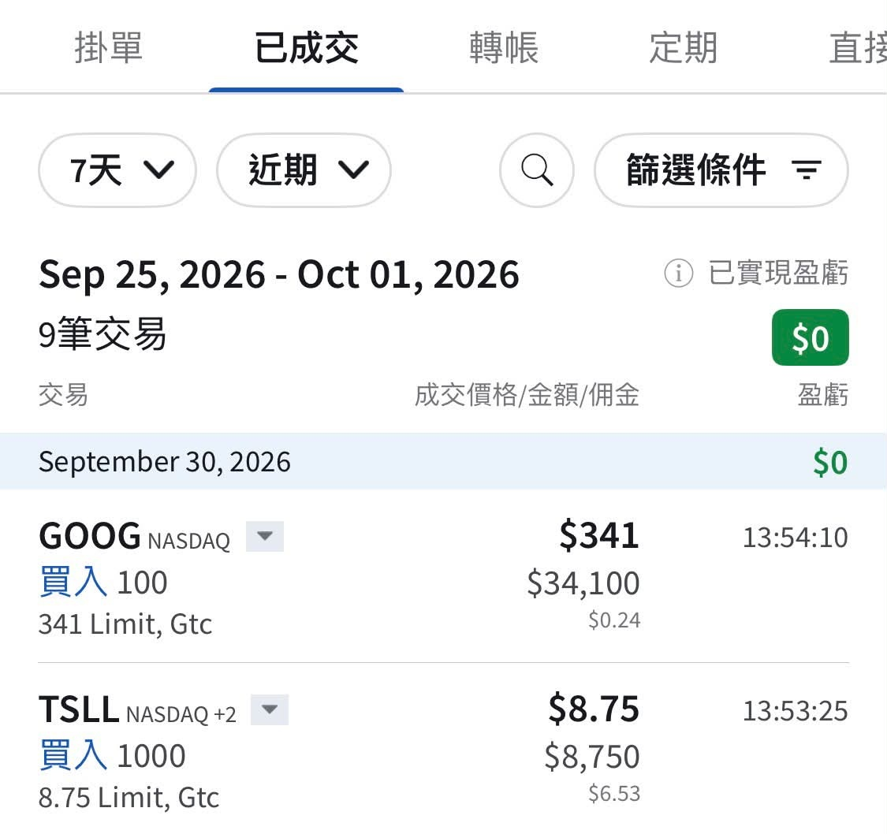

# Introduction: Where I Stand on the Market

**Date:** 2026-10-01

---

A lot of new friends have shown up here,
so let me introduce myself again.

Today is 10/1.
The 30-year US Treasury yield has just broken 5.6%,
but I still believe the US Treasury's red line will hold.

Also,
QQQ's forward P/E has dropped to 21.65.
What was the lowest forward P/E in March–April last year?
23.4.
It's even lower than last March!!!!
At a relative low, when it's time to get in, you get in.

Especially when the Treasury is handing you a free put:
if something goes wrong later, it's the one holding up the floor.
Or does everyone still think the Treasury is the one that's going to break? 🤣

## Replies

> Reader: Getting on board with Dad 😤

Position control~

> Reader: The old man can't control the Fed, but he still has his Treasury Secretary. The Treasury is his best enforcer!!

The market wants to test the Treasury.
The problem is, if the test really does turn up a problem,
what comes after will be quite a show 🤣

---

Original post: https://www.threads.com/@edgeless.blade/post/Dd8ZYrnDgDL
