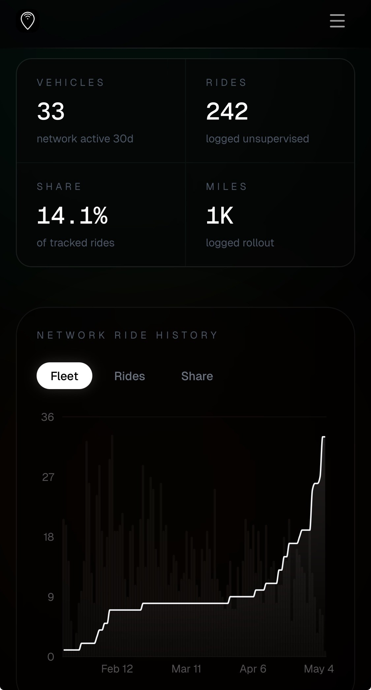

# Tesla's Mispricing: Only Good News Left

**Date:** 2026-05-04

---

The market's pricing of Tesla right now is stuck on a crucial mismatch

The bad news of the past few quarters, demand worries, slowing growth, the big jump in Capex, has basically been digested by the market over and over. When bad news no longer brings new information, the price naturally stops falling on the same old story.

What still isn't fully priced in is FSD's progress.

The next numbers to catch the market's eye
are this set:
"how fast the unsupervised test fleet is growing"
Once FSD goes from concept to cash flow
money will rush into this value trough

Where the real moat is:
Most self-driving companies are still validating technology, but Tesla already has three things at once:
technology, production capacity, and software distribution

Production capacity is easy to underestimate
When everyone's Robotaxis are mature, others will have to slowly build out their fleets, but Tesla won't, because it already has enormous capacity on its production lines. The big jump in capex is precisely to build the even cheaper Cybercab

Even more important is how it deploys:
No retrofits, no extra hardware, just push the operating build over OTA and existing inventory instantly becomes usable assets. That means scaling has almost zero marginal cost, with practically no bottleneck to expansion

So the question now isn't "is there any more bad news," but when the market starts to realize that "Tesla's future holds nothing but good news"

Look at how steep this climb is

## Replies

> Reader: Musk says wait for FSD V15

Yes
That doesn't stop smaller versions from testing first
Once the test fleet scales up
the market starts reacting
It doesn't need to, and won't, wait until the very end
The market likes to run ahead

> Reader: Diamond Hands😭

TS is slowly seeing the light

> Reader: In the future, logistics companies will have nothing but Semis and Optimus hauling cargo. That's what I see in my dreams.

Amazon has already brought quite a lot of them into its logistics warehouses
Specialized work settings
don't necessarily need such expensive robots
But the beauty of general-purpose ones is
on the consumer side they can do anything
I can't wait for that world

> Reader: Tesla's vision may arrive late, but it will arrive (gaze unwavering)

It's just that the pie in the sky is often big and dry

> Reader: Pumping!

With intent to induce app-opening

> Reader: Sorry, just felt like being cheeky

We've built up a high tolerance
Go trick the newbies🤣

> Reader: The rate of likes tells me how cold it is up here on the mountaintop

Got it
Stylish

> Reader: Tesla's pumping

The market isn't even open yet
Don't experiment on me🤣

> Reader: The Grand Master is flexing

I just wanted to post a chart
It rocketed from 28 cars to 33🤣🤣
For this one chart I even had to write a whole post

---

Original post: https://www.threads.com/@edgeless.blade/post/DX5zXvVkdRl
