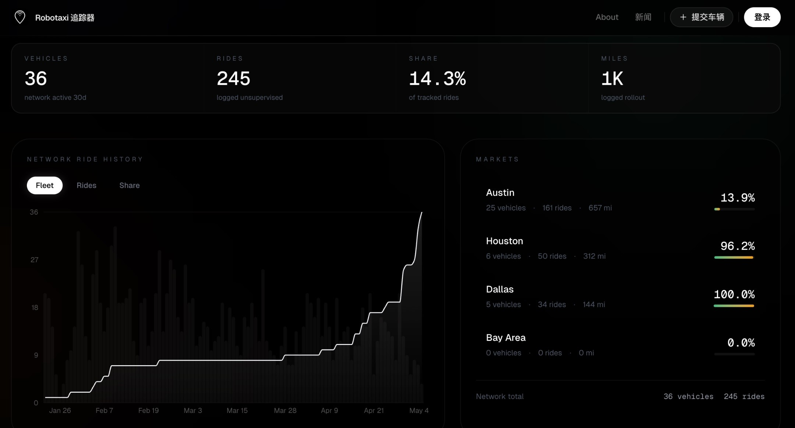

# Robotaxi Fleet Surges 9% in a Single Day

**Date:** 2026-05-05

---

Tesla's Robotaxi testing is accelerating
The unsupervised fleet surged 9% in a single day
Actual total: 33 → 36 cars 🤣

## Replies

> Reader: That's way too fast, a whole 3 more cars

A whopping three more cars

> Reader: At 36 cars, 2 people are lining up to buy the stock
> At 360,000 cars, everyone will be scrambling to buy XD

You and me?
At 3,600 it'll already be pumping
At 360,000 it might pump all the way to Mars

> Reader: Where can I see this data?

robotaxitracker
Just search for it

> Reader: Thanks☺️

> Reader: We used to laugh at Waymo, and now they've left us miles behind

It's only just started to climb
Once deployment matures
Tesla's advantage is huge

> Reader: 😮‍💨 If only the boss would stop bragging

> Reader: Vroom vroom, the engine's starting

Motor
It's a motor

> Reader: EVs don't go vroom vroom

> Reader: Bitcoin's pumping

> Reader: If this were the share price
> I wouldn't be here fooling around
> No idea what I'm so busy with, staring at fleet counts all day

It'll get priced in gradually
Three cars won't move it
+300 cars a day will

> Reader: It's fine, at 300 cars
> I'm going to stuff myself at A Joy, Dog Bro

I'll book out 300 seats at A Joy

---

Original post: https://www.threads.com/@edgeless.blade/post/DX8ORWnESrI
