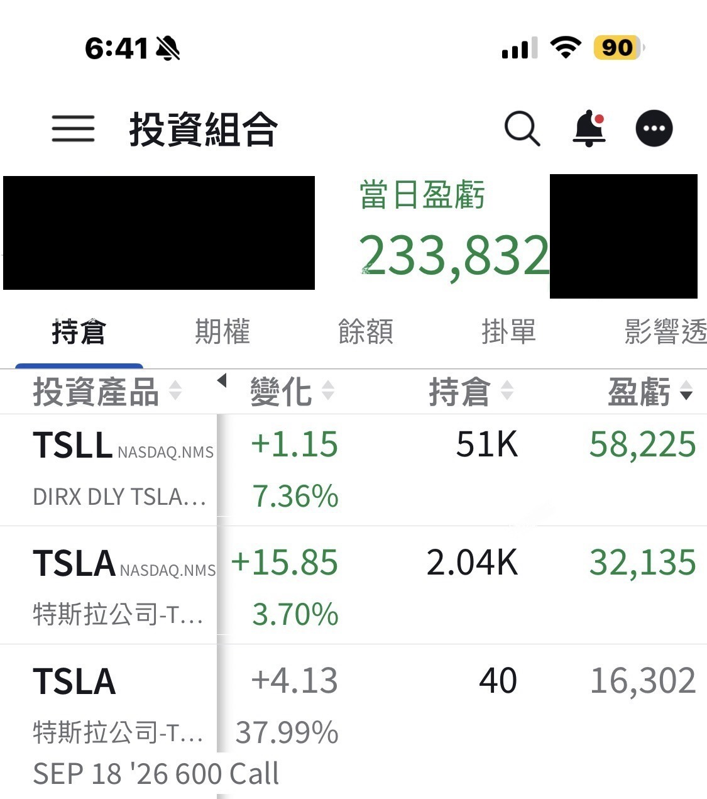

# No Light, No CPUs, No Space: +$230K in a Day

**Date:** 2026-05-12

---

It's not that old-timers don't buy meme stocks
it's that the meme stocks old-timers buy stop acting like meme stocks

No Light
no CPUs
no storage
no space
+$230K in one day
I really did my best
Call it the Tried-My-Best round

## Replies

> Reader: Is it punishing everyone who sold at last month's low?

> Reader: Finally no more enoki mushrooms for dinner...
> Eat something nice this week, who knows when it'll be back to enoki

LOL
don't bring that up at breakfast

> Reader: I go grab a midnight snack, turn around and it's up 4%
> The group's all partying and I missed it 😢
> Ol' Tesla pumping on tabloid headlines, so on-brand
> No way a China visit makes it rally like this
> And yet it did haha 🤣 garbage stock
> Whoever wants it can buy it; if nobody does, I will

> Reader: Big Bro, your "best effort" is my dream

The Tried-My-Best round

> Reader: The garbage truck finally moved 😭

You have to start it up once in a while
or the battery dies

> Reader: Love T, buy T, wait for T

> Reader: TSLL go go, the light has finally come

TS, slowly seeing the Light

---

Original post: https://www.threads.com/@edgeless.blade/post/DYN_lkrEytN
