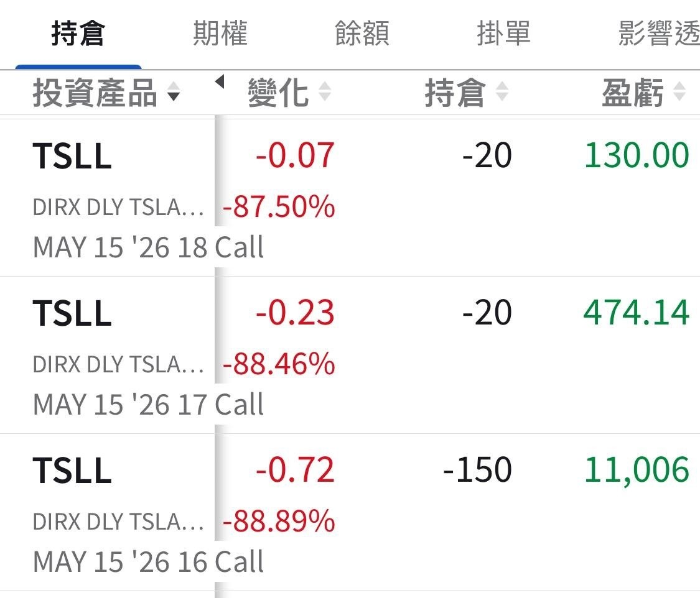

# US Stocks, That's Not Very Sporting of You

**Date:** 2026-05-15

---

US stocks, that's not very sporting of you
When optics, CPUs and memory were rallying, I got no piece of it
So how come when it all drops, I get swept in too
Down US$330K right at the open

## Replies

> Reader: The whole clan, executed

Everyone else wipes out nine degrees of kin
My Great Ming can go to ten

> Reader: Time to say it again: what kind of janky stock is Tesla, anyway

That's putting it pretty politely

> Reader: What the hell, how did this happen

> Reader: Quick, sell some and buy memory stocks

> Reader: It's always on a Friday that the Domain Expansion drops

Unlimited Void

> Reader: Last chance to hop on🤡

> Reader: Isn't the market not even open yet? Is this after-hours?

> Reader: Tesla's blasting off

> Reader: Whipsawed up and down all week. I'd rather just get a Shinra Tensei, flatten everything at once and get it over with

Shinra Tensei kills people🥹

> Reader: How many floors are you gonna hold up?

> Reader: Down over a million US dollars, yesterday and today felt like a sauna-then-ice-bath🤬

> Reader: It's... it's not time to panic yet😱

Not panicking
but the money's gone🥹

> Reader: Trust in Zhe Zhe

For me, Zhe Zhe is still stuck in his hundred-million-in-US-Treasuries era

> Reader: Deep pockets, as expected

> Reader: Insane. That's way too much of a gamble

There I was, just sitting at home

> Reader: when a tank suddenly smashes through the door

Freeze
FBI

> Reader: I just wanted to pop downstairs for a drink

> Reader: I took profits on TSLL yesterday. It was the plan: if the underlying broke below 432, I'd get out

Lucky you
My sell calls at 16, 17 and 18
swept the whole table
Guess I'll run it again next week

> Reader: I don't get it... I only got into US stocks 2 weeks ago... could you explain?

> Reader: Lately a bunch of rich folks have already taken profits and cleared out
> I don't really dare go in big and chase the highs😂

> Reader: Hang in there, hang in there, let's see if it gets better by June

I've been hanging in so long I'm about to make Jōnin
Hang in any longer and I'll be Hokage

> Reader: I feel so much better after reading this, thanks Big Bro
> I'm fine now, I'll go back to sipping my Starbucks

> Reader: Relax, next month's earnings will definitely send it flying back, someone's bound to hype the earnings

> Reader: A little Tesla dip is good too. Let the shares change hands, then it'll have the legs to keep climbing

> Reader: Daring to buy Micron at this level…

> Reader: Damn girl

> Reader: That's pole-vaulting in the outhouse: way over the top, and right over the crap

> Reader: Uncle, what happened to the Tesla 500 you promised😭

> Reader: ⋯this one would make me cry😭

> Reader: Shows you're just a bandwagoner

> Reader: So jealous, only Daddy has a stack big enough to drop this much

> Reader: Kinda right, and kinda not

---

Original post: https://www.threads.com/@edgeless.blade/post/DYXKvqVkWSc
