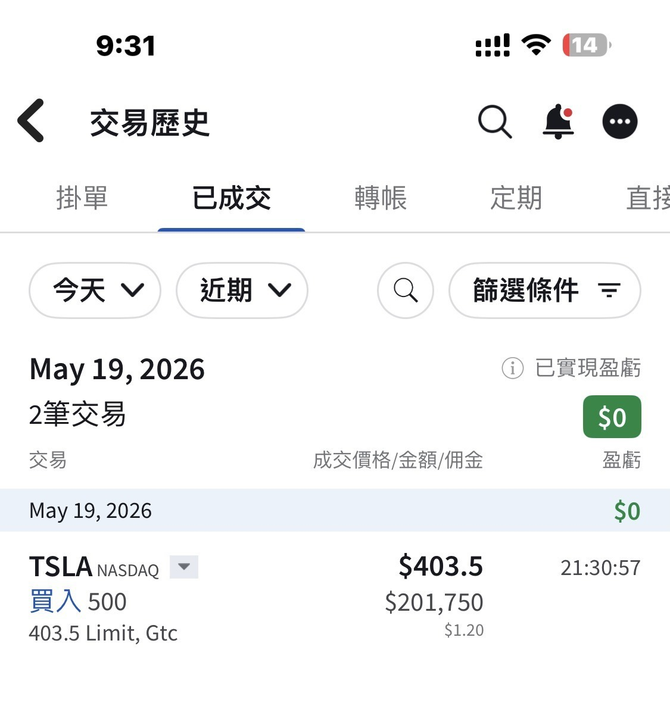

# Sorry, Couldn't Help Myself

**Date:** 2026-05-19

---

Sorry
couldn't help myself for a moment
topped up another 500 shares of Tesla

## Replies

> Reader: Infinite Money♾️ Jutsu

Hard-Earned-Cash-Down-the-Drain Jutsu

> Reader: Caution, vehicle reversing! Caution, vehicle reversing!

Reverse! Reverse! Reverse!

> Reader: I have to think for ages over 5 shares, and your hand slips and it's 500 shares. Beast

> Reader: Blade Boss, time to charge your phone

Buy first, charge later

> Reader: My whole feed is 520 love-day posts, but what I envy most is still this one: casually topping up 500 shares🫠🫠

> Reader: Getting a bit nervous, since SpaceX is coming to take a cut of the money

> Reader: Will you hold both the upcoming SPCX and TSLA?

I probably won't get a chance to buy SpaceX

> Reader: So rich

> Reader: Where did you find your bank?

> Reader: Hold

hold the door
hold the door
hodl hodl hodl

> Reader: How do you just casually buy 500 shares😱

Not casually
just accidentally

> Reader: With Tesla you never have to worry about selling too early
> because it always comes back to the starting line to pick everyone up

> Reader: Smart, this is exactly when you buy in bravely

Brave or not, I can't say
It's full of bitterness

> Reader: It's all pocket change

> Reader: Bro, save me

> Reader: What's the reason you're bullish?

Waiting for FSD to be officially delivered

> Reader: Thanks for sharing. Looks like a long-term play, then?

> Reader: So impressive👍

It counts as an impulse buy

> Reader: Rich…….

> Reader: Leaving a comment to watch the tycoon

Watch while you still can
the show might close one day

> Reader: Add to your position, young man

Gone numb

> Reader: Ouch~

Lost so much I'm numb

> Reader: We bow before you

Let's all pray to Musk with every meal🤣

> Reader: Bro, let me charge your phone for you

I'll charge it once it goes up

> Reader: No way, bro, I'm charging it first. This wave has to go up, I'm still holding

> Reader: Holy crap, he casually buys and it's a million

Take out "casually"
and the sentence holds

> Reader: Thank you, Musk

> Reader: Deepest pockets win in the end

> Reader: Making money till you're numb

Making money? Not necessarily
Numb? Definitely

> Reader: Bro, do you happen to need a little brother?

> Reader: Your faith is moving

Where I made it
is where I give it back

> Reader: Daddy save me, glug glug

> Reader: Don't you think Tesla will drop when SpaceX lists?

Not necessarily
but sentiment is definitely already at a low
Of course, low can always go lower
but sentiment is definitely already at a low

> Reader: What app is this?

> Reader: I know you've still got money

No
I don't know that

> Reader: If you're rich and bullish on Musk, you could buy some Google

> Reader: It's at 394 now

Even cheaper
Too bad I bought too early

> Reader: Signing my name on a legendary thread

> Reader: Tesla's chart could be a big Wyckoff third top, maybe trapping every big retail holder all at once when SpaceX splits off and lists, with SPX falling to 4000 and blood in the streets

Then I'll just go down with the ship alongside Elon

> Reader: Brutal. I'm still thinking about whether to get in😂

> Reader: Tesla 2x long, +1000 shares

> Reader: Not bad

> Reader: Daddy's stepped in to prop up the price, Tesla's spring is on its way

> Reader: Whale alert

> Reader: The deeper I'm trapped, the deeper I go

> Reader: You know your stuff

---

Original post: https://www.threads.com/@edgeless.blade/post/DYhaTMMEfGP
