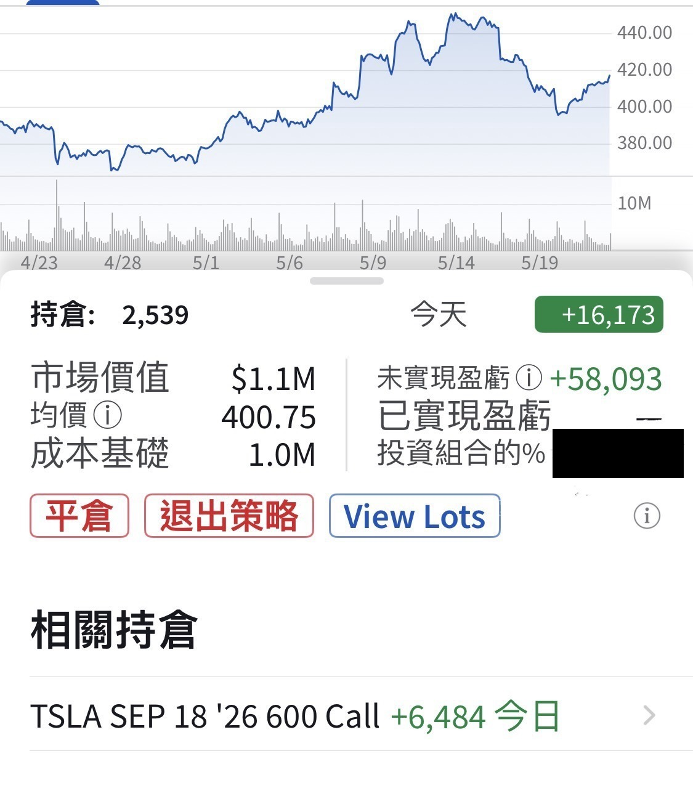

# How I Built My TSLA Position

**Date:** 2026-05-21

---

A quick rundown of how I built my TSLA position
1/16: bought 900 shares at 430
4/6: bought 1000 shares at 363
4/9: got cold feet, only bought 100 shares at 344
From 5/7 on, for every unsupervised test car Tesla puts on the road, I buy one share
39 shares so far
5/19: bought 500 shares at 403
2539 shares in total so far, cost basis 400🥹
Friends who follow me know
I hold around 50,000 shares of TSLL
current cost basis is 16
So I'm laying that out too
(the links below are all scams)

## Replies

> Reader: I really want to go on a huge buying spree too

> Reader: Old position at 332
> New position at 411

> Reader: Seeing Big Bro still here puts my mind at ease about my Tesla position

If it doesn't go up soon
I'll have to wait until next month

> Reader: Let's go! On top of my long-term shares, I recently added LEAPS calls around 400.
> Let's ride this all the way to the end together.

Here's hoping it's a smooth-sailing match

> Reader: SpaceX is about to list. After that you could sell your Tesla and move it all into the rocket, the rocket's the company Musk truly controls

> Reader: Whale

> Reader: It's the Year of the Horse, so keep the faith in Elon "Dragon-Horse" Musk🚗

The feng shui's all lining up👍

> Reader: Trend-wise, 500 will be here soon

> Reader: I'm heading to Wugu (literally "Five Shares") in a bit

Placing an order for five hundred shares

> Reader: Hello, esteemed senior. As a tiny little retail investor, I'm left gaping.

> Reader: Powered by faith

And faith keeps getting put to the rack

> Reader: Waiting for old Musk to announce at year-end that SpaceX is buying Tesla at a premium of 800 a share

If that really happens
500-600 is about right
Too low and TSLA shareholders will cuss
Too high and SpaceX shareholders will cuss too
Could it be that after the merger
I end up an investor with my hands full of SpaceX

> Reader: Tesla-la superfan

> Reader: I thought you were stocking up every single day, Daddy

> Reader: Reversing over people
> Time to drive forward

The ones it runs over are the shareholders

> Reader: The comments are packed with tough guys

> Reader: Tesla's blasting off

> Reader: It really bugs me that Musk said SpaceX isn't a profitable company, but I'm definitely buying anyway

> Reader: Welcome to join my group (this URL doesn't exist haha)
> www.Tsla.hitting.500.this.friday.and.2000.by.this.year

---

Original post: https://www.threads.com/@edgeless.blade/post/DYldZJvEeNO
