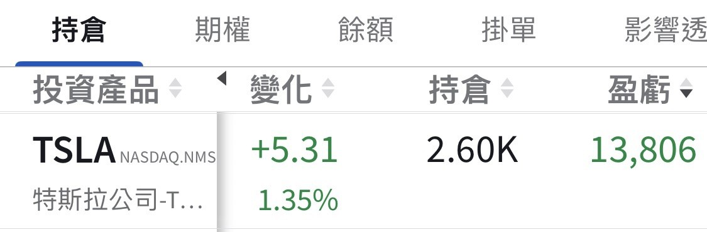
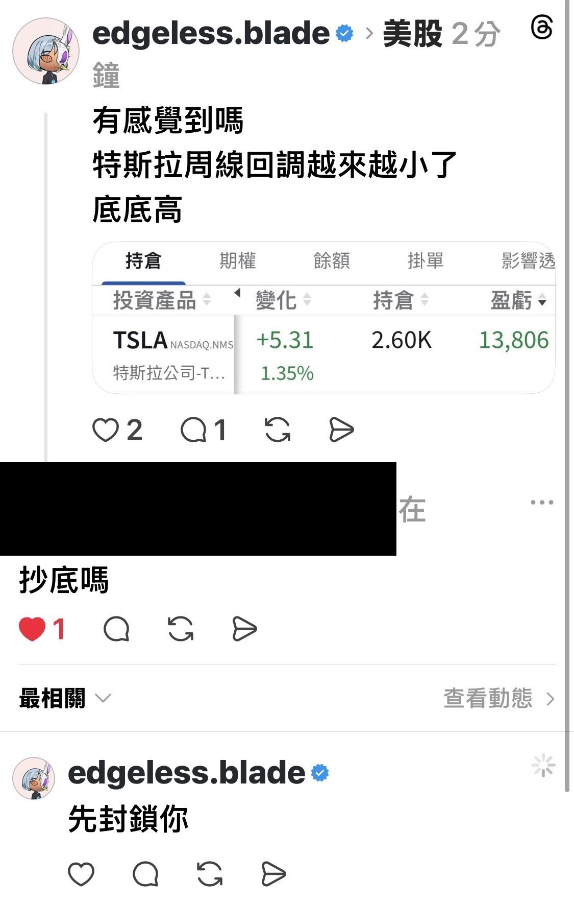

# Can You Feel It? Higher Lows

**Date:** 2026-07-06

---

Can you feel it
Tesla's weekly pullbacks keep getting smaller
Higher lows

Two minutes into the game
already bagged one

## Replies

> Reader: FSD Full Self-Driving, now with fully autonomous, self-aware price control

Full Self-Breakeven system

> Reader: Nope, don't feel it

> Reader: Lower highs

That too🤣🤣
So it's converging, waiting to pick a direction

> Reader: Don't feel it

Then Tesla had better step it up

> Reader: What about your TSLL, bro?

Switched to shares at the end of May
The whole bull market was really frothy back then
I was afraid a pullback would take it all down with it
so I had to swap the 2x for regular shares
Too bad I held it so long
and it didn't end up great
only made a few tens of thousands
After all, I expected FSD
to go live by the end of 2025
Didn't expect it to drag on this long

> Reader: Would you consider adding a bit more now?

Actually I still have 600 shares at HSBC in Singapore🤣

> Reader: How could you bear to, when it's so pretty!

Can't even be bothered to spell properly

---

Original posts:
https://www.threads.com/@edgeless.blade/post/DacVYHHkTux
https://www.threads.com/@edgeless.blade/post/DacVuySkRbA
