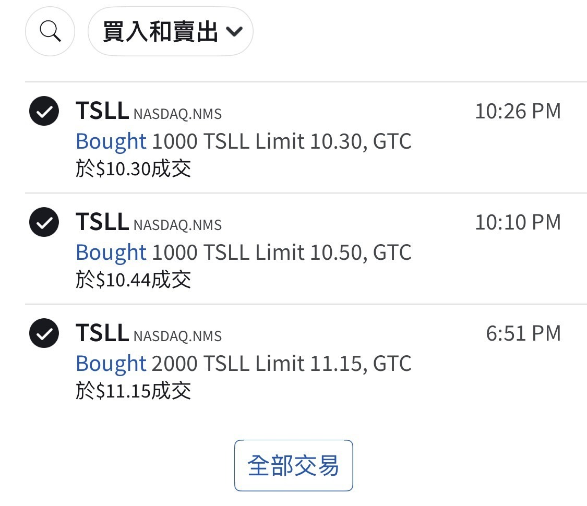
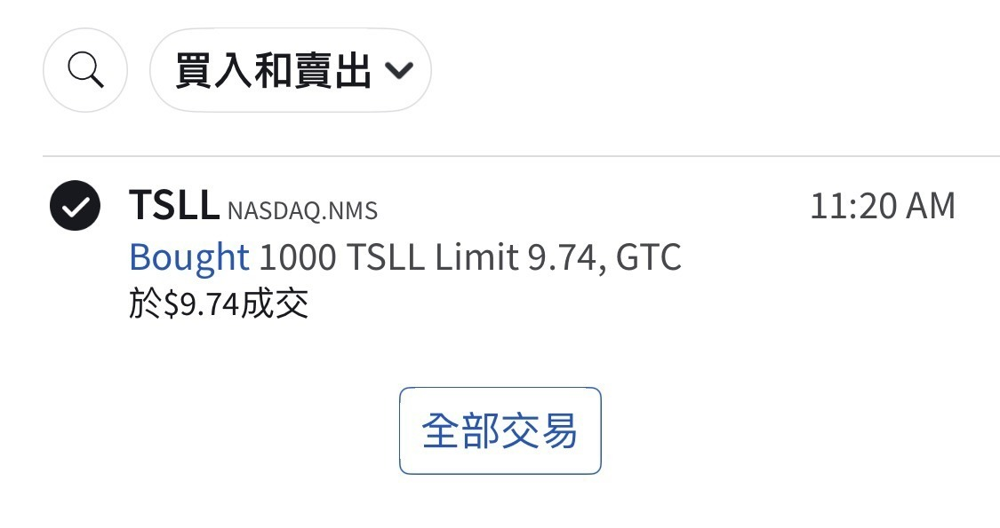
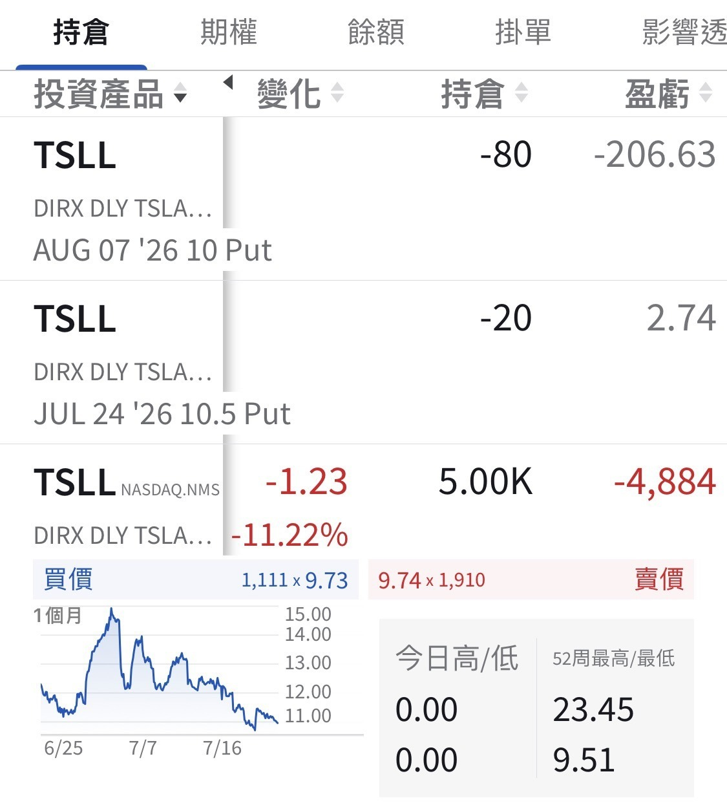

# Tesla Flattened Me Right After I Bought

**Date:** 2026-07-23

---

Just finished buying
and Tesla went and beat me up

Listening to you all
just added another 1000 shares premarket
Counting the 100 sell-put contracts I already had open
I should end up catching 15,000 shares
Have I done right by you all now? 🤣

## Replies

> Reader: Looks like the table's full. Bro, mind if I pile onto the trade?

Buy your own
Pile onto mine and I might bolt on you

> Reader: Already picked up my cardboard box this morning, ready to report to the park

Did the organizers announce the zones today?
Or is the whole park reserved for Tesla holders?

> Reader: Maybe the Google crew will come keep you company

> Reader: So jealous of you, boss, being that rich

A drunken, wasted life doesn't scare me
Grand ambitions do

> Reader: Am I the only fool who tapped "All trades"?

> Reader: Keep buying~

Whatever you say

> Reader: Today he dares to beat me up, tomorrow he'll go conquer the world, waaah

> Reader: Lying flat.......flat flat flat~~~

Averaging it down flat

> Reader: It's fine, you'll be winning by year-end

Whatever you say, adding another 1000

> Reader: Scumbag Tesla behaved for exactly one day, then went right back to beating up its shareholders……

I thought he was off to conquer the world
Turns out he's still beating up shareholders
By my count, isn't it about time?

> Reader: I went and tapped "All trades" again

Your broker's UI is that stiff, huh?

> Reader: Stiffer than my phone screen. I tapped till the screen cracked and it still wouldn't open

> Reader: Are you playing this like an online game? Doesn't it hurt at all?

---

Original posts:
https://www.threads.com/@edgeless.blade/post/DbH4bPekWUG
https://www.threads.com/@edgeless.blade/post/DbIVYeQEQcE
