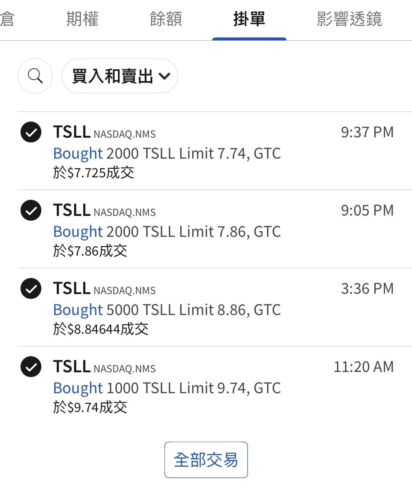
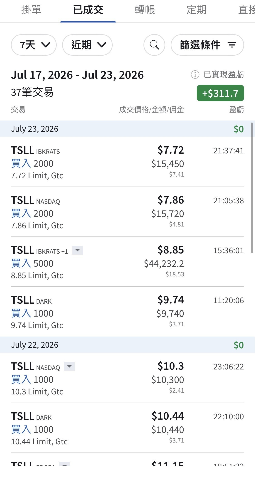

# Not Much Cover Fire, but I Did My Best

**Date:** 2026-07-24

---

Not much cover fire
but I did my best
Yesterday I bought tsll all the way down, 10,000 shares
14,000 shares across the two days

## Replies

> Reader: Thank you, 9527 (the classic Stephen Chow sidekick number)

What are you buying with the insurance payout?

> Reader: If there's anything left after paying off my credit card, maybe a City Café coffee

> Reader: Are you going to keep buying until you own more shares than Elon…

> Reader: Damn, everyone's going all out

Missed that haha

> Reader: Following you in!
> 💸💸

> Reader: Leaving my name on this legendary thread

Not legendary
Just buying like a fool

> Reader: Truly capable people really are humble

There are no permanent winners in the market
but I want to stay in the market forever🤣

> Reader: Boss, where does all this cash flow come from! I'd like to learn

> Reader: 99588 (save me, boss)

> Reader: This really is a relatively long-term low to buy some, hold a while, and sell once it clears the previous high

Let me know when you sell~

> Reader: Will do~

> Reader: Came to see the rich folks😍

> Reader: Is everyone counting on a Musk miracle?

The price is pretty good now

> Reader: A life of overnight riches

Thanks for having so much faith

> Reader: Tesla's Grand General

> Reader: Daddy, do you have infinite deposits?

No top-ups
Just the one bankroll

> Reader: Save me (995)

> Reader: Do you pair it with selling at-the-money calls? Since tsll has decay. Thanks

> Reader: Big whale

A tiny skiff in a raging storm

> Reader: It could also go back to 5 bucks, its low

It could

> Reader: Infinite ammo, insane

I spend within my means

> Reader: I only bought 100 shares, small-timer here

---

Original post: https://www.threads.com/@edgeless.blade/post/DbKeUtHET93
