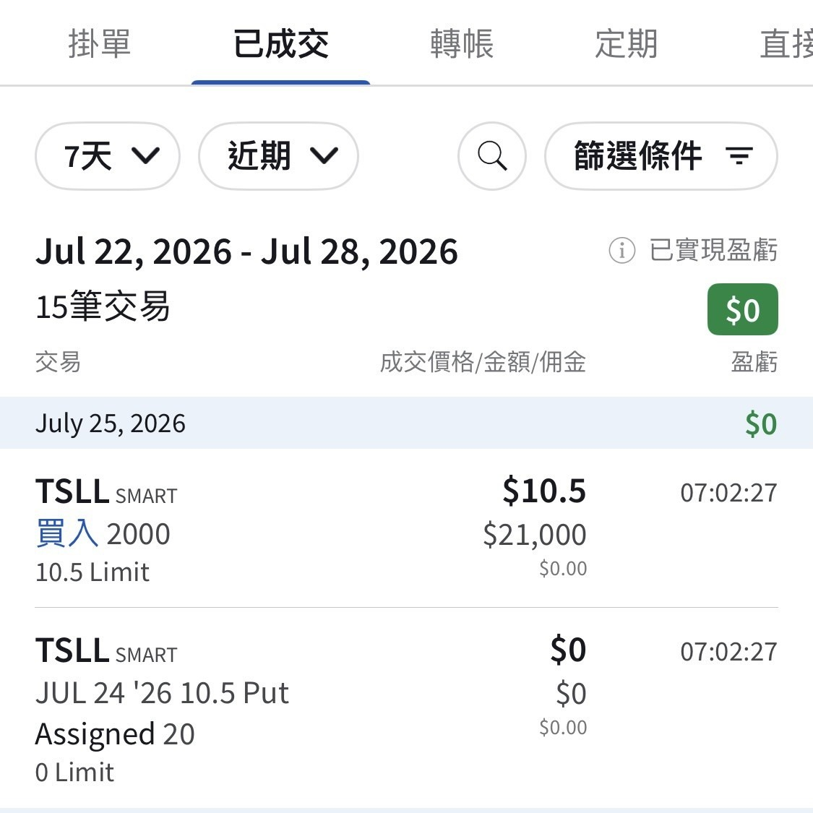

# Stuck With Another 2,000 Shares

**Date:** 2026-07-28

---

Got stuck with another 2,000 shares🤣
The new shares were 30% off the moment they landed
Thinking it over🤔 maybe I should just buy a car instead

## Replies

> Reader: Bro, you've got to hold on……

Veteran bag-carrier here
Don't you worry
So heartwarming

> Reader: The car really is sweet

The car is a great car
The stock is ___

> Reader: Next life, let's buy the bottom together

> Reader: I don't own a Tesla, but the money I've got stuck could buy one. Is that a fitting description?

Too bad
I've got both

> Reader: Is this good or bad 🤣 does it count as faith?

Not quite faith
Just experiencing Tesla's tech on the front line
It's genuinely been good for many years
Waiting for unsupervised FSD
to open up across an entire state

> Reader: Bro, you're hitting kind of hard

The market's hitting hard

> Reader: 7.02

Worse than 30% off

> Reader: Sweet price

Sweet
Way too sweet
My blood sugar's spiking

> Reader: Keeps trashing the chart😂

> Reader: A real ruthless one⋯

---

Original post: https://www.threads.com/@edgeless.blade/post/DbU0bUAkaLb
