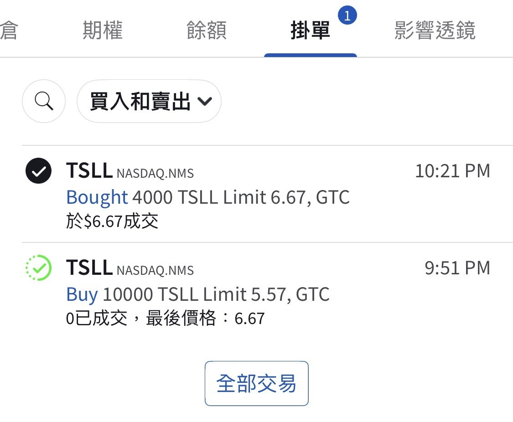

# Boarding the Hell Train

**Date:** 2026-07-30

---

Tesla
The hell train pulled in
I hesitated for a moment
then got on anyway🤣

## Replies

> Reader: I sold 7 puts

700 shares!

> Reader: Misunderstanding, I meant I sold one put at 7 bucks

Not bad either

> Reader: I don't dare get on. Where's the last stop?

It's the Mugen Train, with no last stop

> Reader: Conviction

> Reader: Heedless Blade

Have we already reached this stage?

> Reader: Can't wait for you to reach the final stage: no sword at all

> Reader: Big bro didn't lose. Little bro just deleted the app first😭

> Reader: All I can do is applaud

Much obliged

> Reader: Wow, came to see the rich guy

> Reader: Big bro won't retreat a single step.

> Reader: Guess I'll grudgingly follow at tomorrow's close🤣

> Reader: The decay is kinda scary. Back when the stock was at 250, it was 6 bucks

Going long with leverage
always comes at a price
For double the position
if you bought shares outright
the cost wouldn't be low either
Overseas, the cost of capital is above 5% across the board
and that's assuming you can even borrow the money

> Reader (in Korean): ㅋㅋㅋㅋㅋㅋ so the Taiwanese hyungnims got wrecked by TSLA too
> ㅋㅋㅋㅋㅋㅋㅋㅋㅋㅋ
> it got me too ㅋㅋㅋㅋ

---

Original post: https://www.threads.com/@edgeless.blade/post/DbZ5sbCCFQM
