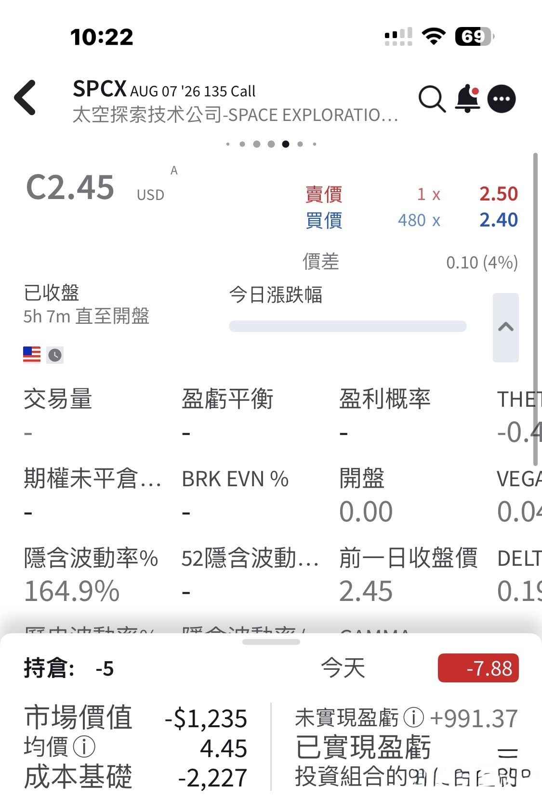
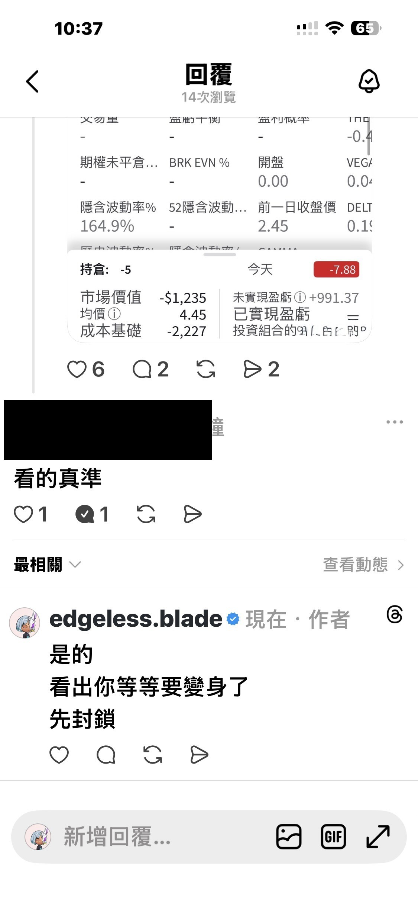
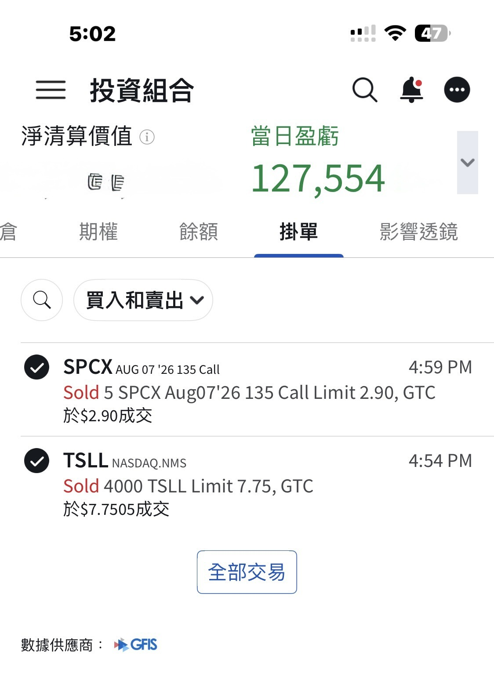

# Wheeling SPCX, and How to Spot Scams

**Date:** 2026-08-03

---

When SPCX opened at 150
I bought 1,000 shares, then dumped them at 170
Later I caught them again at 150
and dumped them again at 160

At 135 I used a sell put
to pick up another 1,000 shares of SPCX
then followed up with another sell call
This week's sell-call cycle is coming around again
So far I've only opened 5 contracts, average 4.45
I'll see how things look tonight before selling calls on the rest of the position

If we're talking valuation
I think a return to 1T is a price very much worth buying
1T is a magical threshold
every company that breaks through it
is destined to be a lasting business

When it comes to spotting scams, I've more than earned my stripes
Whenever you see a link while reading a post
please be 120% careful yourself
.
The basic playbook of a scam account goes like this
first, bait the poster into replying with an innocent-looking comment
then change the avatar and the name
edit what the comment says
and slip in a scam link🔗

## Replies

> Reader: Post the receipts first, then talk, stock god😎

Gotta say, this is the first time anyone's told me to post first and talk later🤣
Usually people suggest I'd be better off not doing that
But it's perfectly normal for people meeting for the first time not to understand each other

> Reader: Here comes another one who doesn't know his way around here

> Reader: @[tagged account] Here's your chance

> Reader: TSLL's up today, gonna take some off the table?

I was going to save this for tomorrow's post
but since you guessed it, I'll show you first🤣
The 4,000 shares I picked up on the hell train
I've already gotten off with those
The rest of the tickets higher up
I'll allocate later

> Reader: Foreign investors' short positions top 90,000, everyone's getting liquidated

> Reader: Are you some kind of ghost?
> Up and down, in and out
> and you walk away without a scratch
> Who are you, Zhao Zilong, the war god who rode through the enemy lines untouched?

Not at all
Aren't I still stuck bagholding at the IPO price?

> Reader: That's insane

> Reader: Magical

> Reader: So badass

> Reader: To space!

> Reader: Absolute beast

> Reader: Hahaha

> Reader: Impressive~

---

Original posts:
https://www.threads.com/@edgeless.blade/post/DbkkMDAkbHh
https://www.threads.com/@edgeless.blade/post/DbklB2xkfbK
