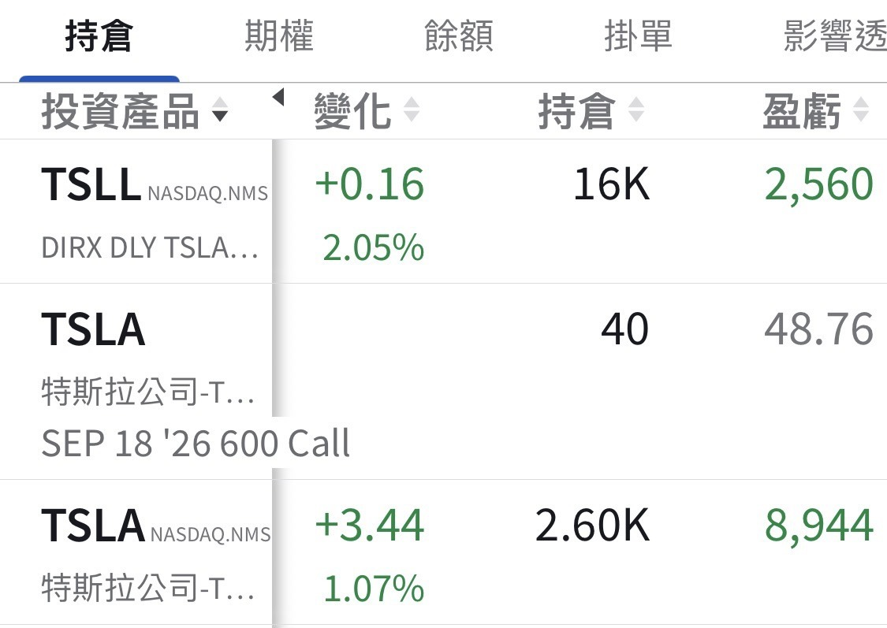

# Off the Hell Train: The Last 4,000 TSLL Shares

**Date:** 2026-08-04

---

Tesla
My ticket for the hell train, the last 4,000 TSLL shares I bought
Turns out the ride was pretty sunny once I got on
And since it's sunny, my mission is accomplished
SPCX can wait till tomorrow

Quoted earlier post (2026-07-30):

> Tesla
> The hell train pulled in
> I hesitated for a moment
> then got on anyway🤣

## Replies

> Reader: Boss, is this a capital reallocation, or are you turning bearish on the trend?

That's a really good question
When you look at someone else's stocks, never look at the absolute numbers
look at the proportion of the overall position👍
.
Those 4,000 shares I really bought when everyone was in despair
to comfort my friends
Now they don't need comforting anymore
so of course I'm selling

> Reader: To close the position, wouldn't it take many times the original?

> Reader: FSD is already AI compute being monetized. The bulls tell stories, the bears make up crashes

> Reader: Very rich

Just bobbing up and down in the sea of life

> Reader: Bro, getting off way too soon, no?

I'm carrying way too much

> Reader: SPCX looks pretty scary tho

> Reader: Tessie is an AI stock now

> Reader: Oh no, bro got off the train... and I only just got on
> Is there still hope for me?

Don't be like that
Let me shuffle some money around, okay🤣
This is a really good price
Keep your position size in check
and I'm confident you'll get great results

---

Original posts:
https://www.threads.com/@edgeless.blade/post/DbmzgEikR0T
https://www.threads.com/@edgeless.blade/post/DbmzmFekeH1
