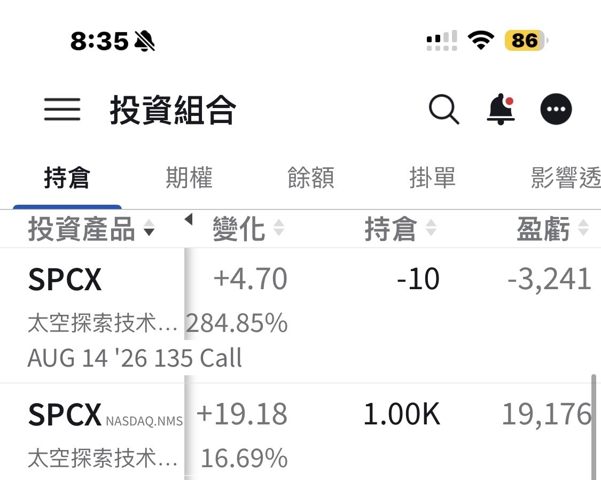

# SPCX: 1,000 Shares at a Cost of 135

**Date:** 2026-08-08

---

SPCX, 1,000 shares, cost basis 135
The premium from the sell put that got me assigned was $4,100
After that, the weekly 135 sell calls brought in premiums of 4,100, 3,100, and 3,600
Looks like I may get to sell the shares soon
The question is, how do I buy them back afterward?
Keep selling puts, of course🤣

## Replies

> Reader: The big rocket ripped!

The move has been surprising

> Reader: Somehow selling puts and selling calls
> on the rocket and on Tesla feels like it has real juice

The rocket is catching a tailwind right now
Premiums are good

---

Original post: https://www.threads.com/@edgeless.blade/post/DbxP9ZWiJzO
