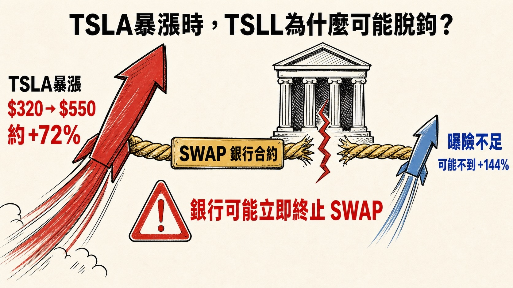
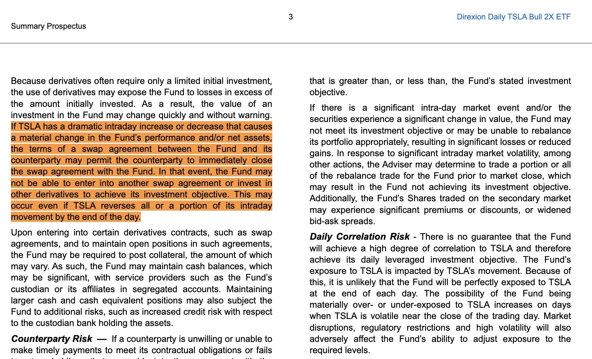

# Why TSLL Can Decouple on a Huge Up Day

**Date:** 2026-08-09

---

Weekends are perfect for a little thought experiment
On why TSLL carries a risk of decoupling

Suppose SPCX makes a takeover offer for Tesla at $550 before the end of the month
And suppose TSLA immediately jumps to around 550 and hovers there

The stock would be up 67% on the day
and in theory TSLL would be up 134%
But on a day like that, TSLL's gain could very well break down and fall short of 2x
landing at only 1.2x to 1.5x TSLA

First off
this is a problem shared by every 2x or 3x product
Let me start by explaining TSLL
Its prospectus says it targets 200% of TSLA's return "from one close to the next close," and that target is before fees and expenses

Next, how does TSLL actually replicate 2x performance?
-It holds TSLA shares directly, about 10%
-It enters TSLA total return swaps with counterparty banks for about 190% exposure

The daily routine:
-TSLL receives the total return on TSLA covered by the swaps;
-It pays financing costs to counterparties such as Barclays, Citibank, Goldman Sachs, J.P. Morgan, and Bank of America
-It's allowed to use options, but doesn't use them much
-It rebalances at every close, so TSLA exposure is back to about 200% at the start of the next day

Next, the explanation:
Why does TSLL decouple when there's a violent intraday rally?

From the TSLL prospectus, verbatim:
"If TSLA has a dramatic intraday increase or decrease … the counterparty may immediately close the swap agreement with the Fund."

In plain terms:
If TSLA rises or falls sharply during the session, causing a significant change in the fund's performance or net assets, the swap terms may allow the counterparty to terminate the agreement immediately. The fund may then be unable to find a new swap or other derivative to restore its target exposure; this can happen even if TSLA reverses before the close.

Simply put
When TSLL is making money hand over fist, the counterparty bank may just close the existing swap and settle the profit to TSLL, but not let TSLL open a new swap position
That directly leaves TSLL without enough position to replicate 200% of TSLA
So in an extreme melt-up, it may very well capture only 1.2x to 1.5x

## Replies

> Reader: Tesla ripped

You're on the hook for that take🤣

> Reader: Is this free to read?😄

Looks like it is🤣

> Reader: What tool did you use to make this chart?

gpt

> Reader: In some market conditions, if TSLA rises a cumulative +50% over a stretch of time, TSLL can easily end up not at +100%, but at +110%, +120%, or even more.
>
> The most favorable case: TSLA rises steadily, day after day.
>
> Here's a very simplified example.
> Suppose TSLA rises +3% every day for 10 trading days straight:
>
> TSLA:
> 1.03¹⁰ − 1 = +34.4%
>
> TSLL at roughly +6% a day:
> 1.06¹⁰ − 1 = +79.1%
>
> If you just double TSLA's gain:
> 34.4% × 2 = 68.8%
>
> But TSLL's theoretical return is actually:
> +79.1%
>
> So:
> TSLA +34.4%
> 2x theoretical +68.8%
> TSLL about +79.1% 🚀
>
> I get what you're saying, but there's also this other case:
> (The above is something I copied — on the upside, it can also run harder than a straight 2x of the underlying.)

> Reader: Almost can't hold on anymore

> Reader: Sell and tell me, then I'll buy

> Reader: So you're waiting until 2029–2030? Unless it reacts early🤣

> Reader: Stuck

---

Original post: https://www.threads.com/@edgeless.blade/post/Dbz3_GWiDUV
Part 2: https://www.threads.com/@edgeless.blade/post/Dbz3_e-iLKh
