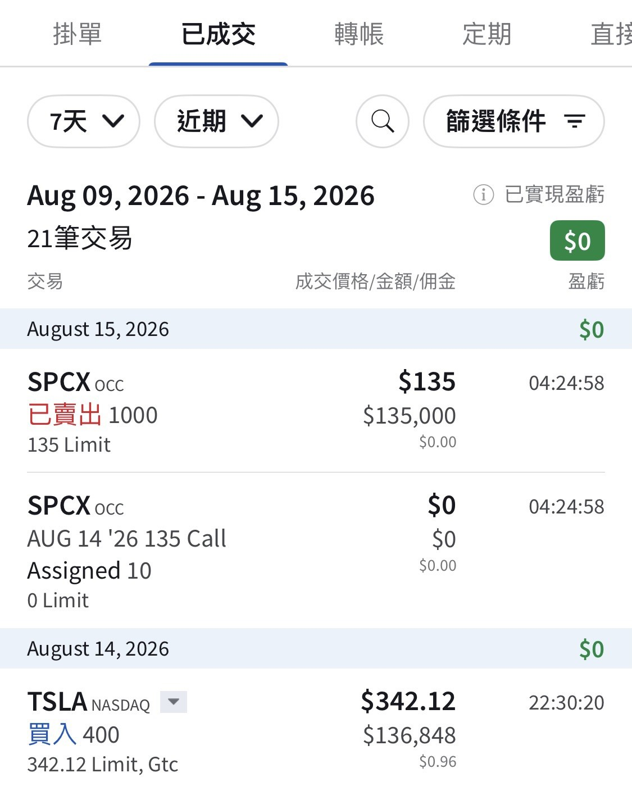

# My SPCX Got Called Away at 135

**Date:** 2026-08-15

---

My 1,000 shares of SPCX got called away at 135
ending a roughly month-long sell-call journey
Then last night I got so caught up chatting that I lost track of time
and forgot to set another sell put to keep the wheel strategy going
So now here's the problem
what do I do with the extra cash?
After some thought, I just stuffed it into TSLA after hours🤣
Another 400 shares makes an even 3,000
We old Taiwan-stock hands just love a share count in neat thousands

---

Original post: https://www.threads.com/@edgeless.blade/post/DcDXvJ6Dp0K
