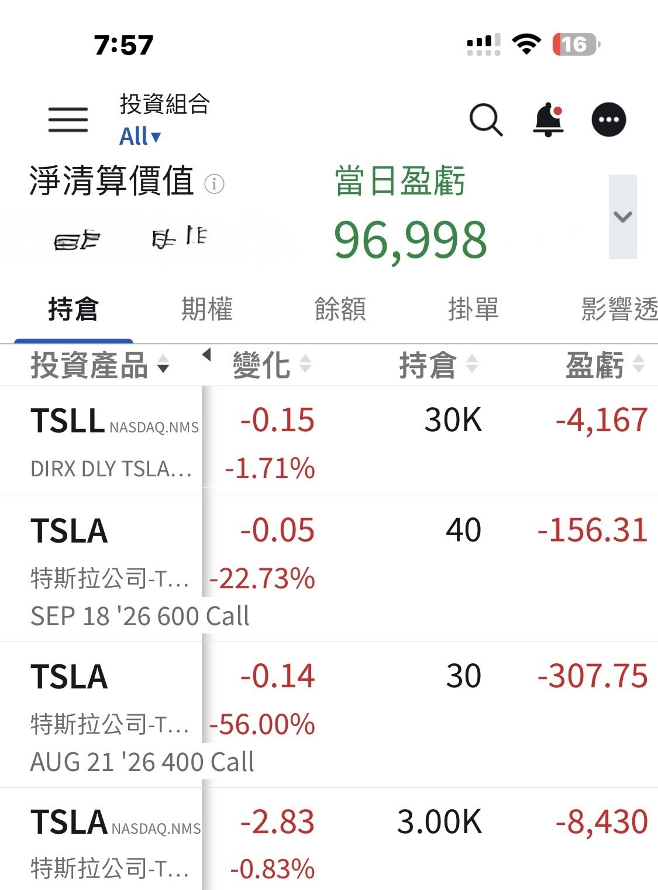

# My Answer Key for This AI Cycle

**Date:** 2026-08-18

---

This is roughly my TSLA-related
position of NT$40 million
I probably won't be able to add much more from here
What I hold at HSBC SG I'm not even counting
Consider it my answer key
for this AI cycle
Now we just wait to check our answers against the market
The more I check, the colder my heart gets🤣🤣

## Replies

> Reader: I thought Master Sword would buy calls, not sell calls

> Reader: I can barely afford a bowl of beef noodles anymore

> Reader: Curious, which trading platform would you recommend?

IB

> Reader: Will it reach 2600 by 2030?

> Reader: Geez, and we get to look at this for free?

> Reader: TSLL is leveraged, you really have to look after that position.

It's fine
The position isn't big
My cost is low
Plenty to look forward to

> Reader: Charge your phone first🪫

Post first, charge later

> Reader: See you at the summit

---

Original post: https://www.threads.com/@edgeless.blade/post/DcLFj5UDrX7
