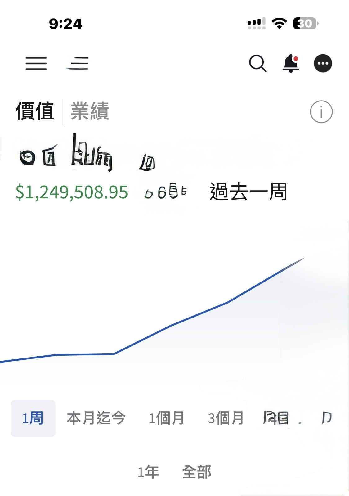

# Riding Tesla and Bitcoin's Breakout

**Date:** 2026-08-22

---

Thanks to Tesla and Bitcoin breaking out
I made back quite a lot this week
My overall account is up NT$40 million

Yesterday I saw the TSLA news out of Nevada: the deployment permit went from 10 cars to 5,000, so before the open I added another 9,000 shares of TSLL

My reasoning: the stock is priced for low expectations
and the market loves linear extrapolation
One state approves 5,000 cars
What if the next state approves another 5,000?

What the market worries about isn't FSD's ability to make money
it's the risk that it never gets delivered
plus the fear of negative free cash flow
Over the past few trading days
both fears have eased a little

Finally, about the merger
Tesla's last annual shareholder meeting was on 11/6
Under the 13-month rule, I figure the next one has to be held before 12/6, and the date is usually announced about 1-2 months ahead, so the day really isn't far off
The most fascinating thing about long-term investing is
miss just a few days of gains
and your whole year's work is for nothing

## Replies

> Reader: The hardest part of long-term investing may not be calling the direction right, but having enough patience to hold on once you have. Missing a few days of gains is a real shame, but chasing the price so you don't miss out makes it even easier to turn a long-term investment into short-term trading: buying high and selling low.

Neither is easy

> Reader: Amazing! Gotta hold Tesla tight, can't miss this wave

I hope the fundamentals keep changing
It's about time they did

> Reader: So fierce. Can't imagine what the real breakout will look like😆

Same life as always☺️

> Reader: Big bro

> Reader: That's brutal

One good week of business feeds me for months😺

---

Original post: https://www.threads.com/@edgeless.blade/post/DcVMYk3CH9X
