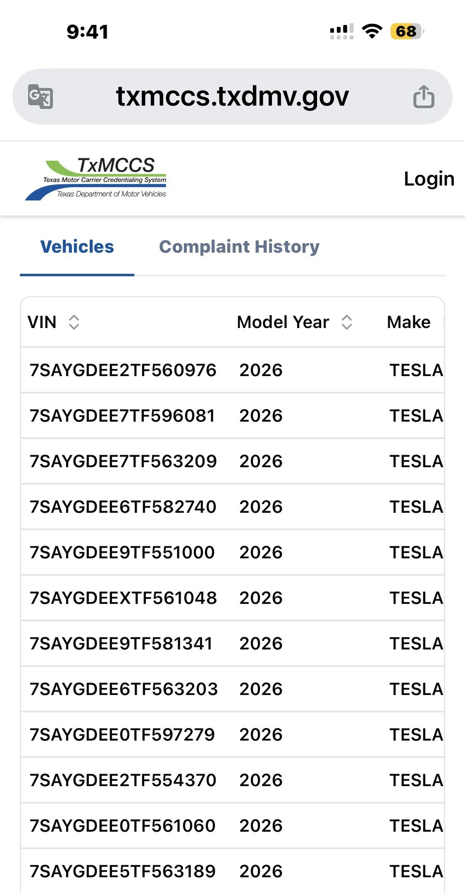
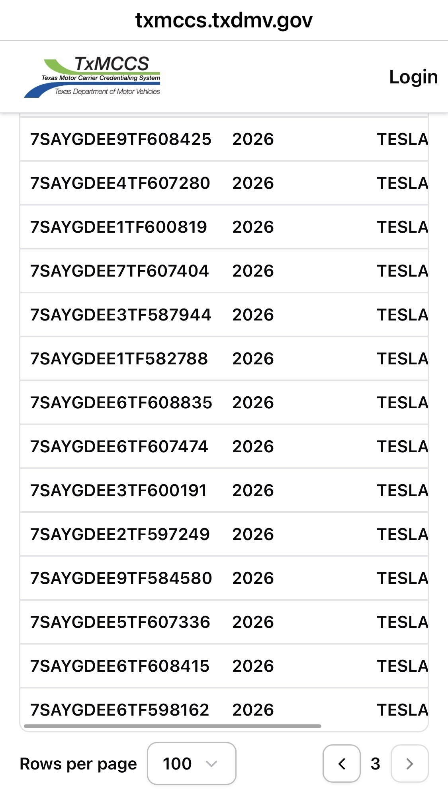

# Texas Robotaxi Fleet Hits 270

**Date:** 2026-08-28

---

Tesla registered 79 more Model Ys as Texas Robotaxi vehicles, bringing the registered Texas fleet to 270.

I went and checked the website
100 cars per page
and it really does go to page three
270 should be about right

Today TSLA is set to rise 0.79%
Don't laugh, don't laugh, don't laugh
Next time they add 1,000 cars
don't come crying with envy🤣

## Replies

> Reader: My lord Chancellor, is the east wind rising?

Judging by the texture of the leather jacket, that's AI

> Reader: A 0.79% gain counts as a moonshot these days🥲

Contentment is its own reward🥸

> Reader: I'll wait patiently
> wait patiently, wait patiently
> wait patiently

You've waited this long already
miss out now and you'll be kicking yourself
and the odds look even better than last week🥸

> Reader: Back in May it was still 577 to 42.
> They're catching up fast, but registered doesn't mean on the road.

Right
Registration is just the step before hitting the road

> Reader: We're that lucky, huh~~

Good thing Tesla has nothing going for it
except having the most cars
Pull one off the factory line any time and there's another

> Reader: Hey hey hey.. it's turned red... TSLA forever

Warsh has spoken
he's the boss
no big deal
with time the odds
keep getting better

---

Original post: https://www.threads.com/@edgeless.blade/post/Dck24xwkWzi
