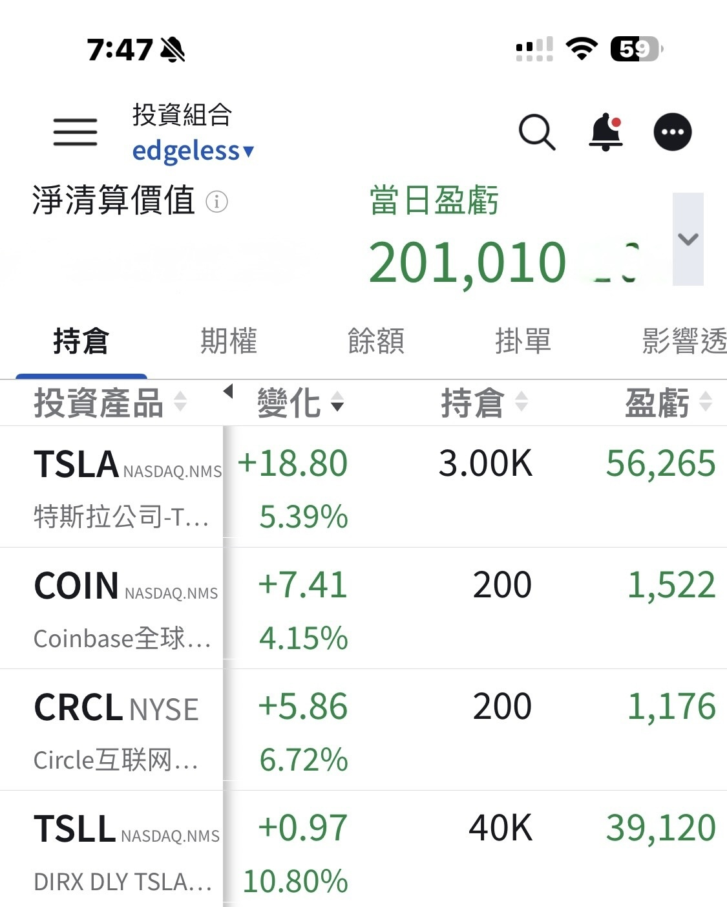

# Carried by My Good-for-Nothing Son

**Date:** 2026-09-01

---

Never thought the day would come
when my gains would be propped up by my good-for-nothing son (TSLL)
Thank you, Tesla
Still up +$200K today

TSLA reclaiming the post-earnings gap
is a big deal
Free cash flow turning negative back then
really did spook part of the market

As long as it fills this gap
and the price gets above 374
it means the market has come around too:
capex really is part of "growth investment"

Nevada approving the deployment
of 5,000 robotaxis within a year
really gave the market a lot of confidence
Time for the market to start thinking about
what happens when the next state approves another thousand or more 🤣

Why can Tesla's P/E be this high?

The race it's running is just that good
and that clear

FSD replacing taxis
robots replacing the labor market

Cut off even a small slice of that cake
and it's more wealth than you could ever eat through

Manufacturing: it has it
Technology: it has it
Execution: it has it

So what's the only question?
When does it roll out?

From where things stand
we're down to the last mile
and we just took another small step forward

---

Original post: https://www.threads.com/@edgeless.blade/post/Dcu9WUviMxr
