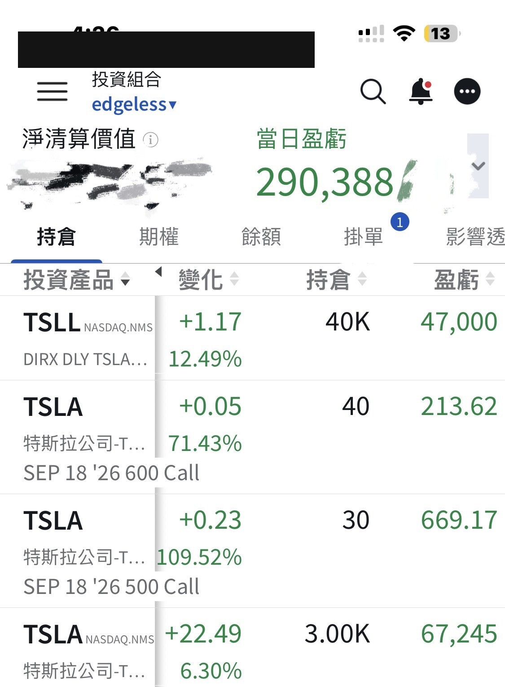
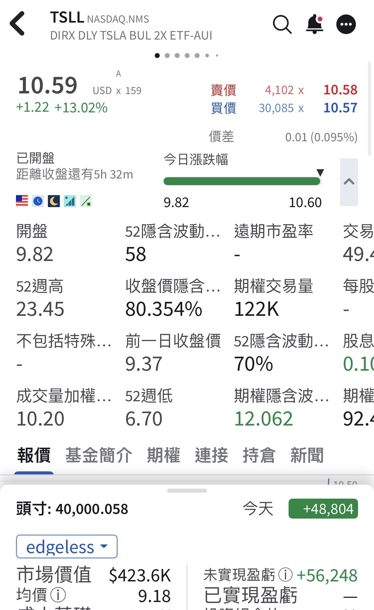
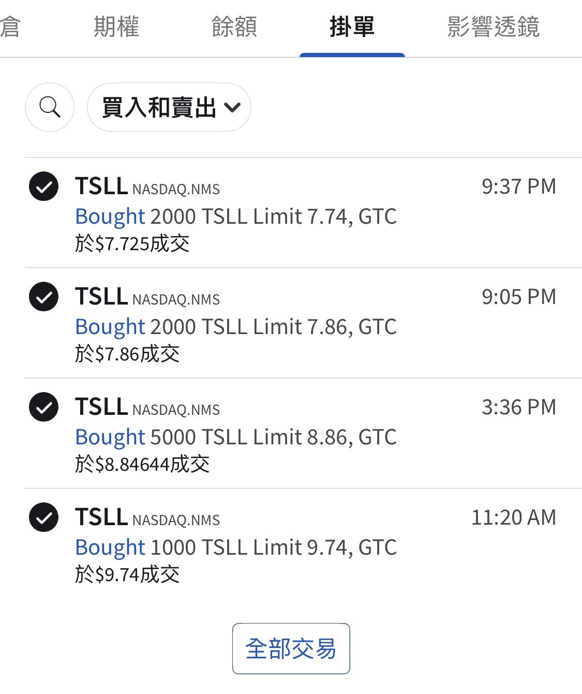
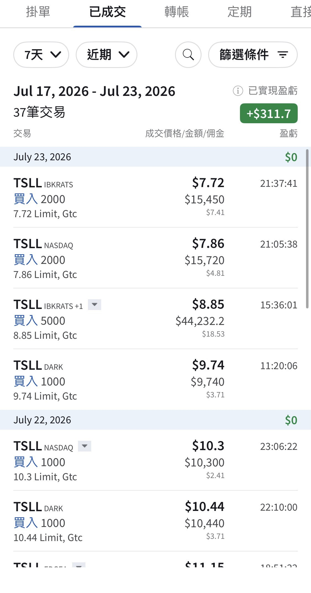

# To the Tesla Battles We Fought

**Date:** 2026-09-03

---

To the good Tesla battles we fought together
From the day of the gap down, I kept catching it left-side all the way
and ended up buying my way to 40,000 shares of TSLL
Unrealized gain right now: over $50,000
Account up $290,000 in a single day
Honestly, the reversal came a lot faster than I expected
Part of why I kept buying all the way down was to cheer up the friends around me who were feeling low
Bargains scooped, bargains scooped🤞

Quoting my earlier post (2026-07-24):

> I couldn't cover much of the retreat
> but I gave it everything I had
> Yesterday I kept buying TSLL all the way, 10,000 shares
> 14,000 shares across the two days

## Replies

> Reader: Grateful to Master Musk, praise be to Master Musk, even though what I bought was SPCX

> Reader: Took half off both of my heavy positions, TSLA and HOOD, now up to 2/3 out. Banking the gains

When sentiment is running high
taking some off isn't a bad thing

> Reader: The market proved Master Sword's call right. You bet on the right big direction (a view of your own, and the guts to back it)

I like the left side
I always buy too early
so I control risk with position sizing

> Reader: I like left-side trading too
> Controlling risk with position sizing, noted!
> This really matters

> Reader: Tesla's ripping

> Reader: Love you Master Sword, love Dog Bro

Thanks
Every win on this battlefield is one you earned yourself

---

Original post: https://www.threads.com/@edgeless.blade/post/Dc1Cj13iH_Z
