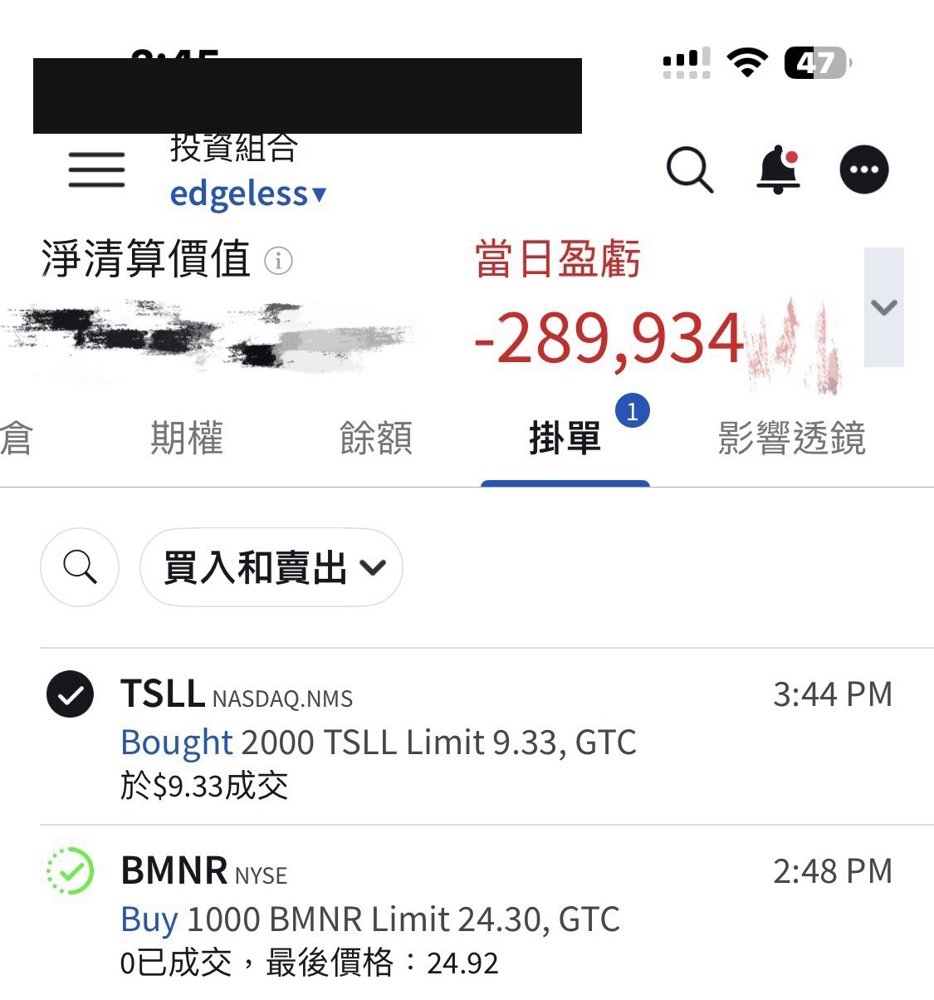
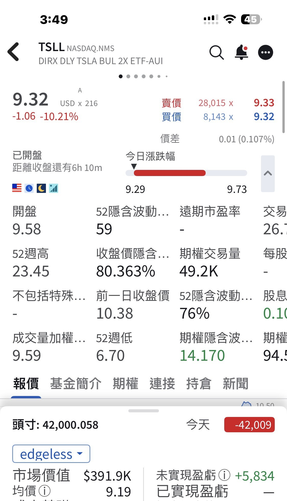
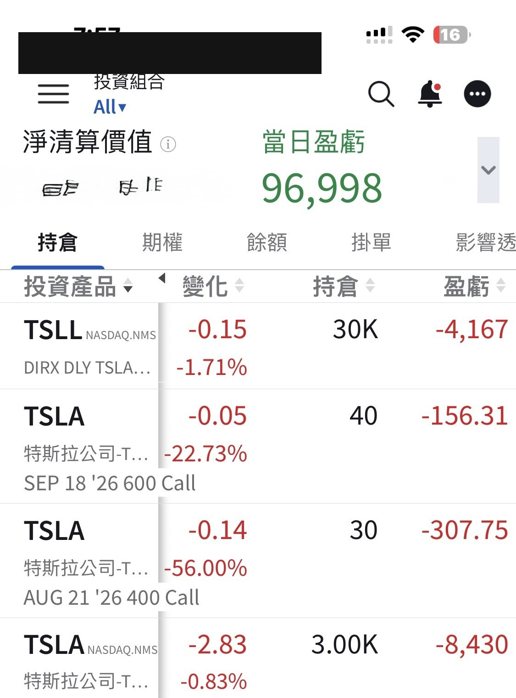

# Covering the Dip, Per Usual

**Date:** 2026-09-04

---

As usual
on a big Tesla down day
I added 2,000 shares of TSLL to cover the retreat for everyone
Total shares: 42,000
Cost basis: 9.19
My unrealized gain went from over 50,000 down to 5,000 dollars🤣

Actually, since 8/18
I haven't touched my Tesla position at all
Today's add was purely a service to all the new friends

Really, don't get too discouraged
Tesla at 350 really is a good entry point
As the Cybercabs roll out one by one
there isn't much time left for us to build our positions

Quoting my earlier post (2026-08-18):

> This is roughly my TSLA-related
> position of NT$40 million
> I probably won't be able to add much more from here
>
> What I hold at HSBC SG I'm not even counting
>
> Consider it my answer key
> for this AI cycle
> Now we just wait to check our answers against the market
> The more I check, the colder my heart gets🤣🤣

## Replies

> Reader: My phone's charged, and Tesla's charging up to take off too

I just spent 18K
and all you care about is my battery level🤯
What a waste of money I am🤣

> Reader: Just added 200 shares of TSLA too, let's go

That's big

> Reader: Master Sword, every time you post your gains, it tanks right after🥲

No worries
Tomorrow you can wait for me to post my losses
It didn't bounce back the day after either
The cost's already been paid
so I can't let the traffic go to waste🤣🤞

---

Original post: https://www.threads.com/@edgeless.blade/post/Dc3iiYriGa3
