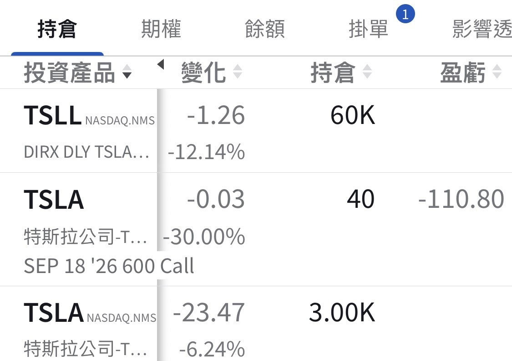

# Tesla's Odds Finally Line Up

**Date:** 2026-09-07

---

The moment when Tesla's odds are most in your favor has arrived

Tesla's biggest risk was that FSD would never actually land
Now it finally has, and along the way it has validated the reliability of the Cybercab as a product
And the Cybercab is already ramping production

The most beautiful part is that at a beautiful moment like this, the market is misjudging the risk, and the stock is still sitting at $350

This window won't last long
Don't let short-term NHTSA headlines
blind you to the fact that Tesla really has cleared its major hurdles

As more and more influencers do Cybercab unboxings
market sentiment will flip to optimism fast

The only foreseeable dip opportunities left are
NHTSA drama
(it'll definitely turn out fine in the end)
and a Cybercab hitting someone🤣

Rest assured, everyone
whenever those opportunities show up, I'll add
So far I've built up 3,000 shares of TSLA common stock
and 60,000 shares of TSLL

If you're truly worried you won't be able to hold on
feel free to tap my profile picture⬆️

## Replies

> Reader: Convinced. Adding more, wiring the money in now

Leave a buffer for the "hits someone" dip🤣
Top up your core position
On a big drop I'll add ➕ big

> Reader: Let's goooooooooo

It all waits for tomorrow's open

> Reader: Old Musk didn't even show up at the event this time, which tells you the garbage truck's Robotaxi business is already a done deal in his mind, so there's no need to come out and paint pies in the sky. The big rocket is the boulder he still can't set down.

Looks like we can finally sum up the pattern
The bigger the show they put on
the more it feels like a religious ceremony
When they just throw something together
the dishes come out unusually good

> Reader: Now I'm torn between waiting until it hits someone (the media will definitely blow it up) before buying, or just slamming in right now aaaah

Your core position should be full by now
Keep a buffer and wait for it to hit someone

---

Original post: https://www.threads.com/@edgeless.blade/post/Dc-Xe5ICAwE
