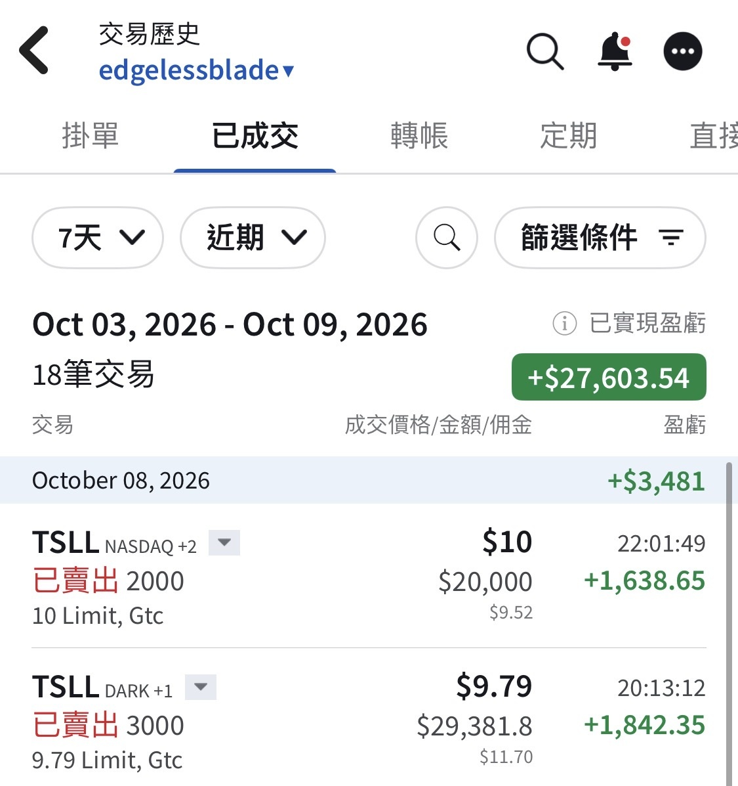

# Tesla Fleet Daily: 150 More Cybercabs in Texas

**Date:** 2026-10-09

---

This one is seriously packed
#Tesla Fleet Daily 2026-10-09

Texas TxDMV (Tesla Robotaxi LLC) has an update

Total: 739 vehicles (589 the day before, up 150)
Model Y: 420 (unchanged)
Cybercab: 319 (169 the day before, up 150)
All 150 new additions are model-year 2026 Cybercabs, VINs 003560 through 003856
Source: the official TxDMV API, which returned 739 records, matching the reported total

NHTSA has pushed back the deadline for Tesla's response to the Cybercab safety-certification Special Order (21 questions in all) by 30 days, to 2026-10-30. Tesla had originally asked for an 8-week extension to November 20 (NHTSA internal memo dated September 29, reported 2026-10-08)
Sources: EV reporting | Not a Tesla App reporting

Media reports say close to 200 Cybercabs have been spotted in Houston

Oh, by the way, I sold 8,000 shares of TSLL yesterday
You guys won't yell at me, right?

---

Original post: https://www.threads.com/@edgeless.blade/post/DeRNkedjm-3
