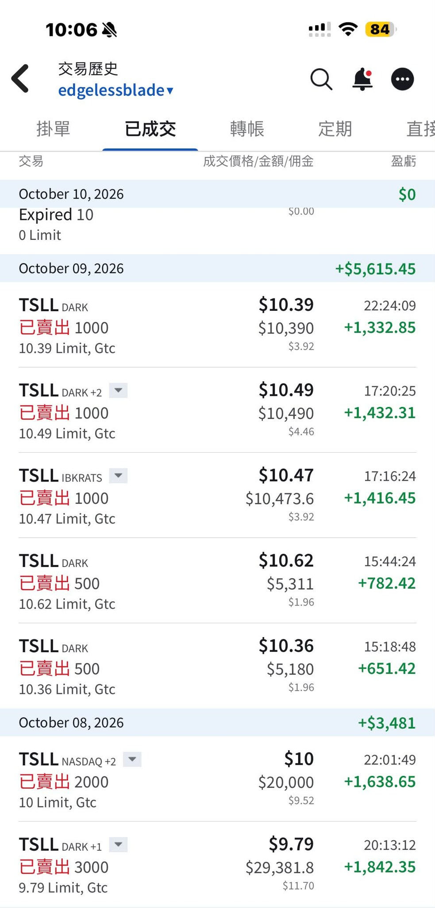
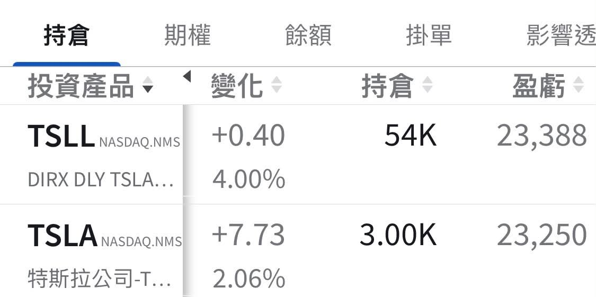

# Covering the Retreat Again, Then Trimming My TSLL

**Date:** 2026-10-10

---

When Tesla tanked in early September
as usual, I took the rear guard for everyone
My 40,000 shares of TSLL became 63,000 in just two trading days

Yesterday I slowly trimmed some
Not because I'm not bullish
It's just that my position plan was always
about 40,000 shares of TSLL and 3,500 shares of TSLA
The core position I hold steady
The extra shares I unload bit by bit
while the news flow and sentiment are good
Yesterday I sold all the way from 10.3 to 10.6
So if NHTSA decides to stage another massacre
I'll be able to cover the retreat one more time🤣

Honestly, though
the Tesla fleet added 150 vehicles on top of 500
With news this dense
this rally gets a failing grade
I don't know what the market is still waiting for

Quoting my earlier post (2026-09-04):

> As usual
> on a big Tesla down day
> I added 2,000 shares of TSLL to cover the retreat for everyone
> Total shares: 42,000
> Cost basis: 9.19
> My unrealized gain went from over 50,000 down to 5,000 dollars🤣
> Actually, since 8/18
> I haven't touched my Tesla position at all
> Today's add was purely a service to all the new friends
> Really, don't get too discouraged
> Tesla at 350 really is a good entry point
> As the Cybercabs roll out one by one
> there isn't much time left for us to build our positions
>
> This is roughly my TSLA-related
> position of NT$40 million
> I probably won't be able to add much more from here
>
> What I hold at HSBC SG I'm not even counting
>
> Consider it my answer key
> for this AI cycle
> Now we just wait to check our answers against the market
> The more I check, the colder my heart gets🤣🤣
>
> https://www.threads.com/@edgeless.blade/post/Dc3iiYriGa3

## Replies

> Reader: Hope it's not waiting for a market correction

I'm leaning more toward
it's about time
time to go up
Waiting for NHTSA Liberation Day

> Reader: Waiting for Blastoise to blast

> Reader: Any chance of another glorious run in Q4?

The only thing still pressing down from above is US Treasury yields
The problem is they can't hold it down for long
Basically it's a bet on America's national fortune
But here's the thing
if Treasuries really do blow up
my positions would be more than happy about it too🤣

> Reader: Too dense, it jammed!

None of the 150 jammed!!!

> Reader: Glorious October

TS: slow but glow-rious

---

Original post: https://www.threads.com/@edgeless.blade/post/DeTpeyUDhdG
