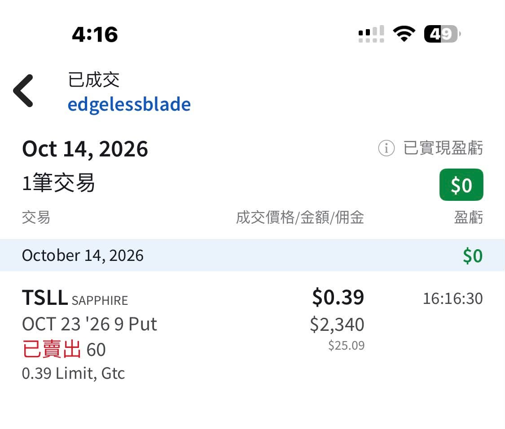
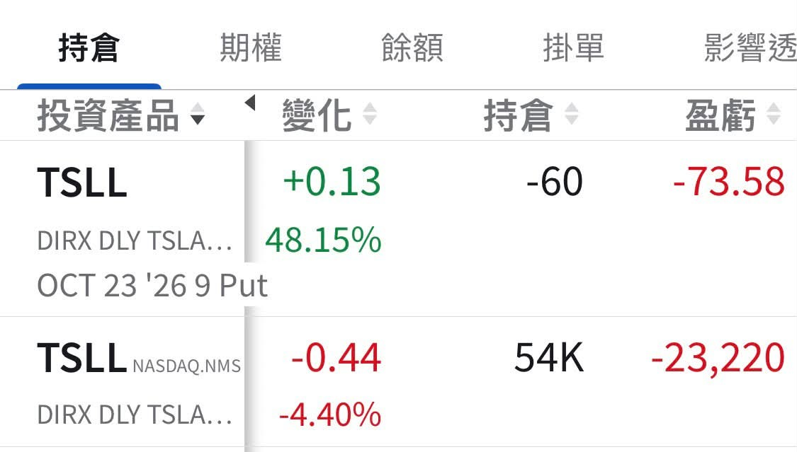

# Plan Your Trade, Trade Your Plan

**Date:** 2026-10-15

---

Plan your trade
trade your plan
NHTSA hasn't brought its massacre yet
but in the CPI massacre I can still help shield Tesla a little
The chips I handed out a few days ago
look like I can catch them back again
Order placed
TSLL sell puts, 6,000 shares
$2,400 collected up front for nine trading days
just right for living expenses

## Replies

> Reader: Does this mean you have no money to lend me?

Yes
I can barely fund my own investing, let alone lend to anyone

> Reader: The infinite train that backs up to pick people up🚄

Almost there, almost there
Can't hold it down much longer

---

Quoted post: https://www.threads.com/@edgeless.blade/post/DeTpeyUDhdG

Original post: https://www.threads.com/@edgeless.blade/post/DegdLnOERV3
