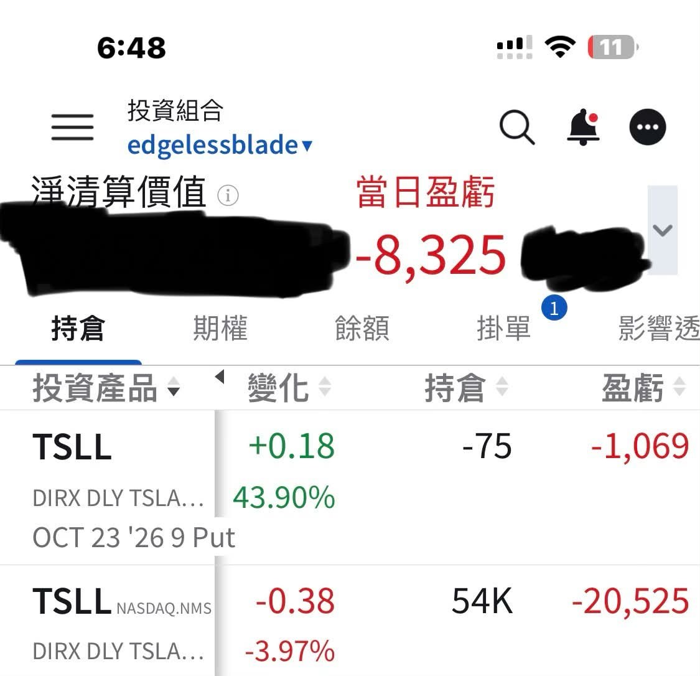
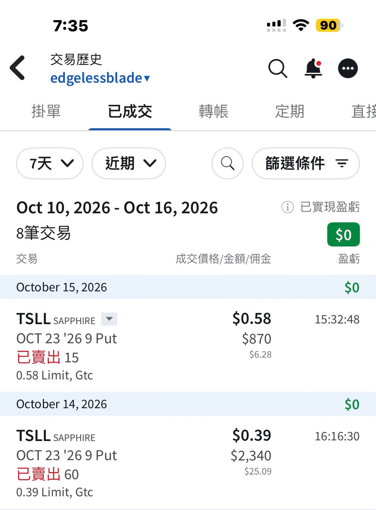

# Kept Adding TSLL Sell Puts While the Market Panicked

**Date:** 2026-10-16

---

These past two days, while the market was in a panic
I kept adding sell puts on tsll, 7,500 shares

Yesterday my account was down as much as $200,000 in a single day
All back by the morning session🥸

Whatever the next 6 trading days bring
$3,000 in premium is already in the bag

A Roadster beyond all expectations🥸
Gorgeous, but I'll pass on ordering one
My 2020 Cybertruck order
is still an interest-free loan to Tesla
To anyone thinking of buying a car:
put the deposit straight into the stock
In a few years the car should honestly be free🤣

## Replies

> Reader: Glorious October

All kinds of surprises
That's the market for you

> Reader: Upvoting this line:
> "To anyone thinking of buying a car: put the deposit straight into the stock. In a few years the car should honestly be free."
> I think so too.
> 🥹🥹

The self-cultivation of a veteran shareholder

---

Quoted post: https://www.threads.com/@edgeless.blade/post/DegdLnOERV3

Original post: https://www.threads.com/@edgeless.blade/post/Deiz-5WjoMV
