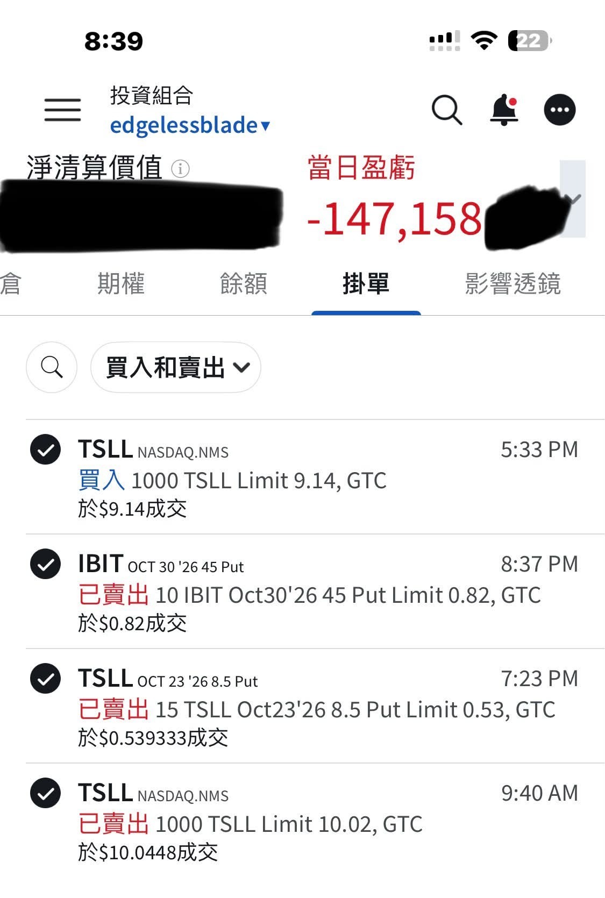

# No Way This Is 2022 Again

**Date:** 2026-10-17

---

No way this is 2022
Back then rates were under 1%, now they're above 3.75%
How are you supposed to run another nonstop hiking cycle from here

And productivity is worlds apart
Everyone already has a secretary
and soon everyone will have a driver too
Paradise is on its way

Yesterday I sold 1,000 shares of TSLL premarket
Never imagined it could get this ugly during the session, so I scooped the 1,000 shares back up at 9.14🤣
Then I remembered the position I'd cleared out earlier
still had room for 1,500 shares, so I sold puts on another 1,500

## Replies

> Reader: Welcome to 2022

Stop opening random portals
I'm not stepping through

> Reader: Really?

In my eyes, it is

> Reader: Okay then, you are my eyes

Planting a ward to keep an eye on the price

> Reader: Boss: "Didn't I give every single one of you a secretary? So why hasn't revenue doubled yet?"

Exactly
The layoffs may be about to start

> Reader: This is painful, my gains have almost turned negative, I'm just no good at stocks😭

> Reader: Keep believing in the investment, top up your faith

Control your risk with position sizing

---

Original post: https://www.threads.com/@edgeless.blade/post/DelomnYDiac
